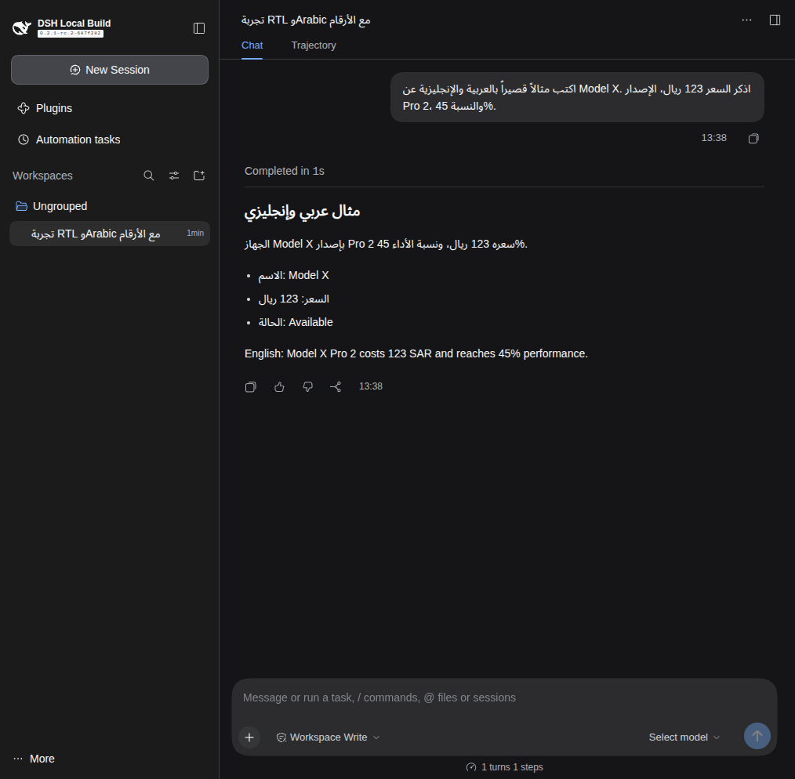
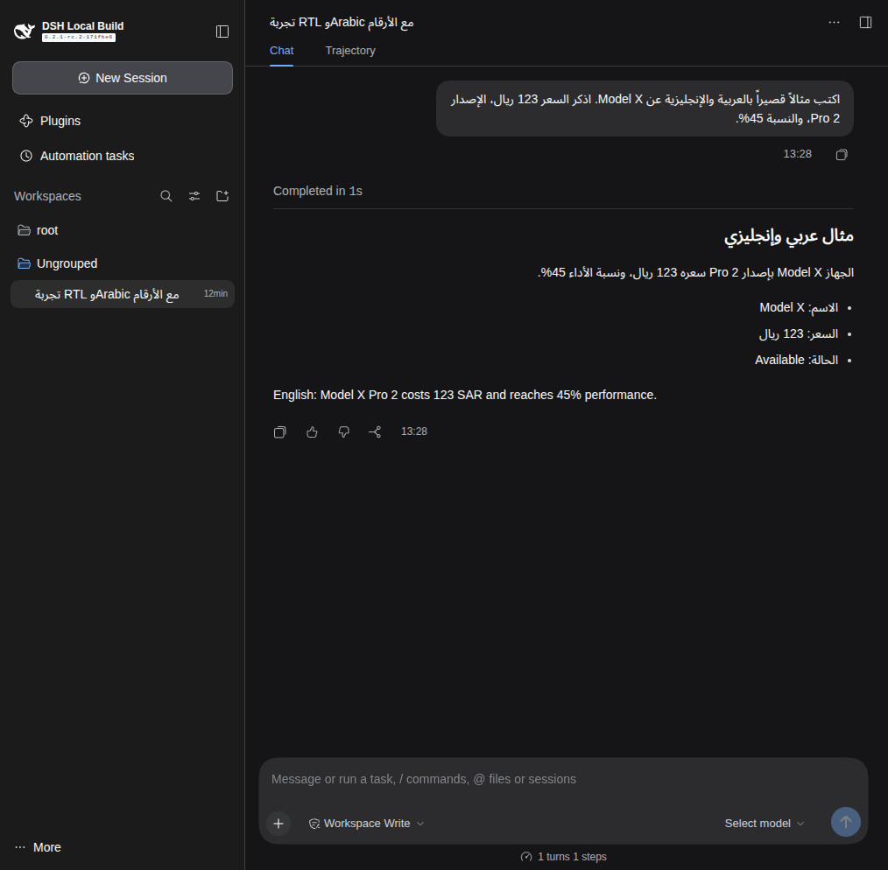

<p lang="en" dir="ltr" align="left">For the English guide, <a href="README.en.md">click here</a>. · <a href="README.zh.md">中文</a></p>

<div lang="ar" dir="rtl" align="right">

<h1 dir="rtl">دعم العربية RTL في DeepSeek Harness</h1>

<p>نسخة مجتمعية مشتقة من <a href="https://github.com/deepseek-ai/deepseek-harness">المشروع الرسمي</a> تضيف اتجاه كتابة RTL للعربية داخل واجهة المحادثة. يشمل ذلك مربع الكتابة، ورسائل المستخدم والردود، والقوائم والأرقام المختلطة بكلمات إنجليزية. يظل النص الإنجليزي وحده باتجاه LTR.</p>

<h2>للمحترفين: تشغيل سريع</h2>

<p>تحتاج إلى Git وDocker مع Compose. الأوامر التالية تبني نسخة هذه الصفحة من المصدر وتشغلها محلياً:</p>

</div>

```bash
git clone https://github.com/tegolley/deepseek-harness-rtl-arabic.git
cd deepseek-harness-rtl-arabic
bash docker/build-arabic-demo.sh
docker compose -f compose.arabic-demo.yml up -d
docker compose -f compose.arabic-demo.yml logs --tail=30 dsh-arabic-demo
```

<div lang="ar" dir="rtl" align="right">

<p>افتح رابط <code>dsh web:</code> الظاهر في السجل على جهاز تشغيل Docker. الرابط يحمل رمز دخول، فلا تنشره. يقتصر الاتصال على <code>127.0.0.1:49251</code>. <a href="docs/arabic-support/INSTALL.ar.md#التثبيت-من-المصدر">تثبيت مباشر من المصدر</a> متاح أيضاً.</p>

<h2>للمبتدئين: خطوة بخطوة</h2>

<ol>
<li>ثبّت Git وDocker Desktop أو Docker Engine مع Compose، ثم افتح نافذة الأوامر.</li>
<li>انسخ الأوامر أعلاه بالترتيب. قد يستغرق البناء عدة دقائق ويحتاج مساحة إضافية؛ بلغت صورة التجربة نحو 5.5GB.</li>
<li>انسخ رابط <code>dsh web:</code> من السجل وافتحه في متصفح الجهاز نفسه.</li>
<li>يمكنك مشاهدة الواجهة من دون مفتاح نموذج. للحصول على رد فعلي، أضف إعداد النموذج من الواجهة ولا تضع المفتاح في GitHub.</li>
<li>جرّب كتابة: <code>اكتب مثالاً بالعربية والإنجليزية عن Model X، مع السعر 123 ريال والإصدار Pro 2 والنسبة 45%.</code></li>
</ol>

<p>راجع <a href="docs/arabic-support/INSTALL.ar.md">دليل التثبيت العربي المفصل</a> إذا احتجت شرح كل خطوة أو تشغيل النسخة على جهاز بعيد.</p>

<h2>كيف يتغير اتجاه النص؟</h2>

<p>تقرأ الإضافة كل كتلة نصية على حدة: الفقرة العربية تتجه من اليمين إلى اليسار مع عزل الأرقام والكلمات الإنجليزية داخلها؛ الفقرة الإنجليزية الخالصة تبقى من اليسار إلى اليمين. ينطبق ذلك على الردود ومربع الكتابة وبطاقات الأسئلة، من دون تغيير محتوى الرسائل أو إرسالها.</p>

<h2>صور قبل دعم RTL وبعده</h2>

<p>الصور تعرض الجلسة التجريبية نفسها داخل واجهة المشروع الرسمي ونسخة العربية. النص والرد محفوظان محلياً كبيانات عرض، ولم يُستدعَ نموذج أو يُستخدم مفتاح API.</p>

<h3>المحادثة بعد فتح الواجهة</h3>

<table><thead><tr><th>قبل: المشروع الرسمي</th><th>بعد: دعم العربية RTL</th></tr></thead><tbody><tr><td></td><td></td></tr></tbody></table>

<h2>التحديثات والملفات</h2>

<p>يفحص <code>Sync upstream</code> تحديثات المشروع الأصلي أسبوعياً ويفتح طلب دمج للمراجعة عند وجود تحديث. لا يدمج التغييرات تلقائياً. <a href="README.ar.md">تفاصيل دعم العربية</a> · <a href="docs/arabic-support/AGENT_INSTALL_PROMPT.md">تعليمات الوكيل بالإنجليزية</a> · <a href="SAFETY.md">إشعار السلامة</a> · <a href="LICENSE">ترخيص MIT</a>.</p>

<p>أمر <code>npx @deepseek-ai/dsh web</code> يثبّت الإصدار الرسمي، ولا يتضمن تعديل العربية في هذه النسخة.</p>

</div>
